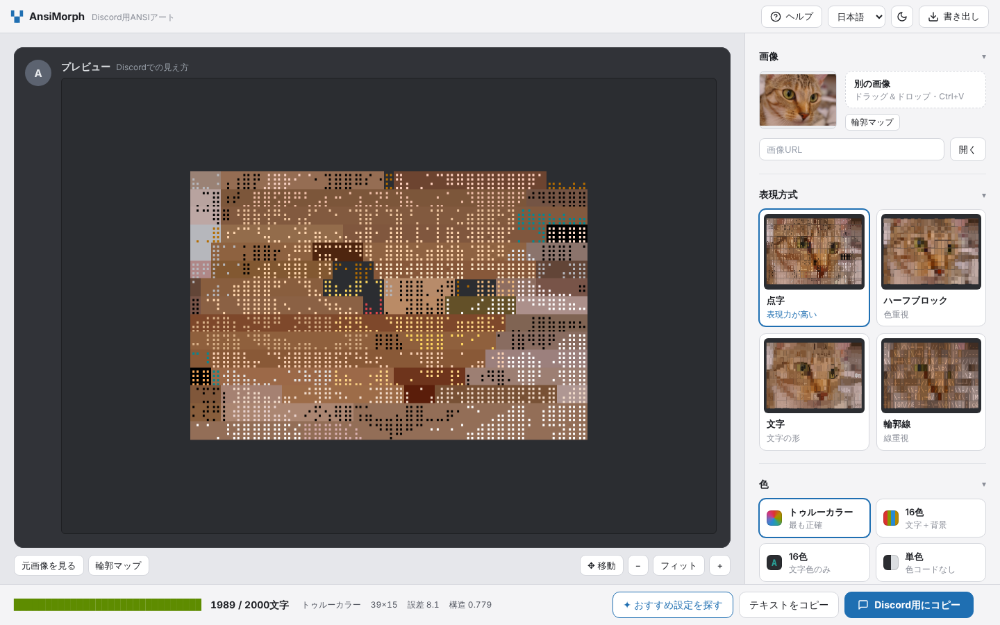

# AnsiMorph

画像を、Discordのメッセージ1件に収まるカラーANSIアートに変換します。

[English](README.md) · [한국어](README.ko.md) · **日本語**



## 機能

- 4つの方式：点字、ハーフブロック、テキスト/ASCIIの文字マッチング、ベクターエッジ
- Discordの ` ```ansi ` コードブロック向けに16色・トゥルーカラーで出力（トゥルーカラーは近い色なら短い256色コードを混用）
- 単色（色コードなし）出力：ディザリングした点字、陰影（░▒▓）付きハーフブロック、文字 — 文字数制限に合わせてサイズ調整、ライトテーマ用の反転
- 色を変える位置を最適化し、文字数制限（既定2,000文字）を必ず守る
- **列数の自動設定**：文字数の上限内に色コードの余地が残るよう列数を選択（60列固定では点字トゥルーカラーがほぼ灰色に）
- **GIF・動画**：アニメーションGIFと動画を自動判別し、すべてのコマを同じ設定で変換してGIFはGIF、動画はMP4で保存
- **✦ おすすめ設定を探す**：制限に合う列数・色数・前処理を提案
- プレビューはDiscordがコードブロックを描く見た目そのまま（行間のすき間なし）、色もその見た目に合わせて選択
- 設定を変えるたびに元画像との誤差を表示
- すべての計算をブラウザ内で処理（WebAssembly＋バックグラウンド処理）、画像はアップロードされません
- 日本語、English、한국어、ライト／ダークテーマ

## 使い方

1. ブラウザで `index.html` を開きます。
2. 画像・アニメーションGIF・動画をドロップ、貼り付け、またはファイルから選びます。
3. 方式とカラーモードを選ぶか、**✦ おすすめ設定を探す** を押してカードを選びます。
4. **Discord用にコピー** を押し、Discordに貼り付けます。GIF・動画は結果の下の **GIFを作成** / **MP4を作成** を押します。

はじめての方は右上の **ヘルプ**（または `?` キー）でスクリーンショット付きの使い方を見られます。

トゥルーカラー・256色への対応はDiscordアプリによって異なり、16色コードが最も広く対応しています。

MP4の作成にはWebCodecsの動画エンコードに対応したブラウザ（最新の Chrome・Edge・Safari）が必要です。GIF・動画は最初の20秒まで、音声なしで変換します。

一部の端末では空白の点字（⠀）がほかの点字より狭く描かれ、行がずれます。そのため点字出力は既定で空白を1点で埋めます（Discord互換の設定）。

## 開発

- ビルド不要：アプリ全体が `index.html` 1ファイルです。
- WebAssembly計算コア：`wasm/` — `sh wasm/build.sh` で再ビルドして埋め込みます（`wasm32` ターゲット対応のclangが必要）。
- 翻訳：`i18n/*.json` を編集し、`python3 tools/embed-i18n.py` を実行します。
- ヘルプのスクリーンショット：`node tools/help-shots.js <画像> <フォルダ>` の後に `python3 tools/embed-help.py index.html <フォルダ>`。
- READMEのスクリーンショット：`node tools/readme-shots.js <画像> docs`。
- テスト：`npm install && npm test`

## ライセンス

[MIT](LICENSE)。スクリーンショットの写真：scikit-imageのStéfan van der Walt「Chelsea」（CC0）。
