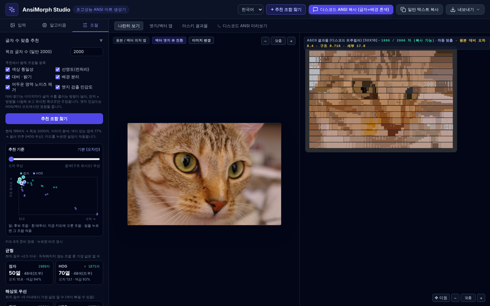

# AnsiMorph

이미지를 디스코드 메시지 한 개에 들어가는 컬러 ANSI 아트로 바꿉니다.

[English](README.md) · **한국어** · [日本語](README.ja.md)



## 기능

- 네 가지 방식: 점자, 하프 블록, 텍스트/ASCII 글자 맞춤, 벡터 엣지
- 디스코드 ` ```ansi ` 코드블록용 16색 · 트루컬러 · 256색(옵션) 출력
- 단색(색 코드 없는 글자) 출력: 디더링한 점자, 음영(░▒▓) 하프 블록, 글자 — 글자 수 제한에 맞춰 크기 조절, 밝은 테마용 반전
- 색이 바뀌는 위치를 최적화해 글자 수 제한(기본 2,000자)을 항상 지킴
- **✦ 추천 조합 찾기**: 제한에 맞는 열 수 · 색 수 · 전처리를 추천
- 설정을 바꿀 때마다 원본 대비 오차 표시
- 모든 계산을 브라우저에서 처리(WebAssembly + 백그라운드 작업), 이미지는 업로드되지 않음
- 한국어, English, 日本語, 밝은/어두운 화면

## 사용법

1. 브라우저에서 `index.html`을 엽니다.
2. 이미지를 끌어다 놓거나, 붙여 넣거나, 파일로 고릅니다.
3. 방식과 색 모드를 고르거나, **✦ 추천 조합 찾기**를 누르고 카드를 고릅니다.
4. **디스코드용 복사**를 누르고 디스코드에 붙여 넣습니다.

처음이라면 오른쪽 위 **도움말**(또는 `?` 키)에서 스크린샷과 함께 사용법을 볼 수 있습니다.

트루컬러·256색 지원은 디스코드 앱에 따라 다르며, 16색 코드가 가장 널리 지원됩니다.

일부 기기에서는 빈 점자(⠀)가 다른 점자보다 좁게 그려져 줄이 밀립니다. 그래서 점자 출력은 기본으로 빈칸을 점 하나로 채웁니다(디스코드 호환 설정).

## 개발

- 빌드 과정 없음: 앱 전체가 `index.html` 한 파일입니다.
- WebAssembly 계산 핵심: `wasm/` — `sh wasm/build.sh`로 다시 빌드해 넣습니다(`wasm32` 대상을 지원하는 clang 필요).
- 번역: `i18n/*.json`을 고친 뒤 `python3 tools/embed-i18n.py`를 실행합니다.
- 도움말 스크린샷: `node tools/help-shots.js <이미지> <폴더>` 후 `python3 tools/embed-help.py index.html <폴더>`.
- 테스트: `npm install && npm test`

## 라이선스

[MIT](LICENSE). 스크린샷 사진: scikit-image의 Stéfan van der Walt “Chelsea”(CC0).
