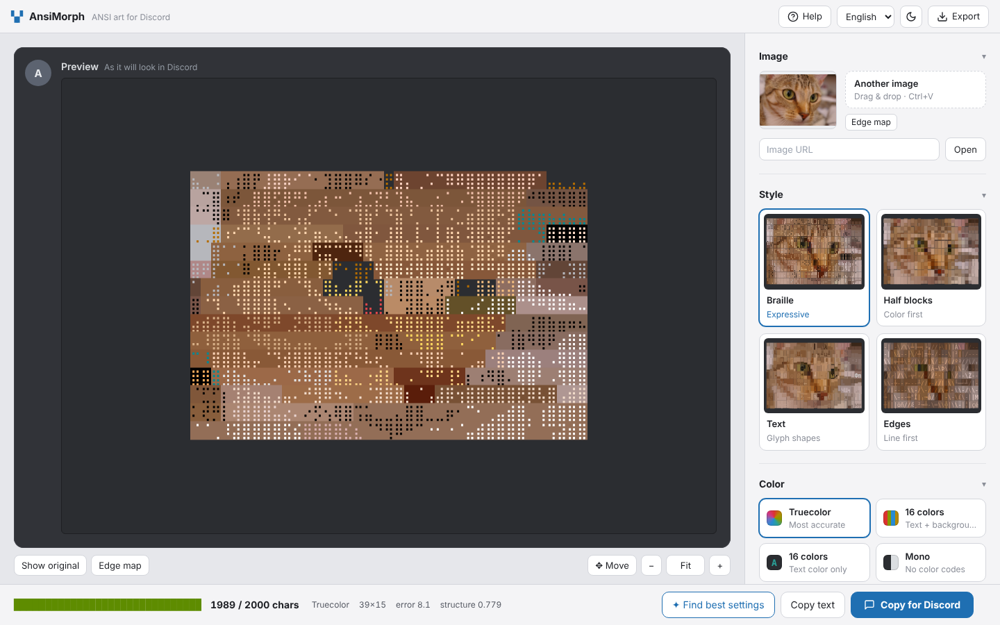

# AnsiMorph

Turn images into colored ANSI art that fits in a single Discord message.

**English** · [한국어](README.ko.md) · [日本語](README.ja.md)



## Features

- Four modes: Braille dots, half blocks, text/ASCII glyph matching, vector edges
- 16-color and truecolor output for Discord ` ```ansi ` blocks; truecolor mixes in shorter 256-color codes where the color is close
- Mono (plain text) output: dithered Braille, half blocks with ░▒▓ shades, or glyphs, sized to fit the limit; light-theme option
- Always fits the character limit (2,000 by default) by optimizing where colors change
- **Auto columns**: picks the column count that leaves room for color codes within the limit (fixed 60 columns left braille truecolor almost gray)
- **GIF and video**: animated GIFs and videos are detected automatically; every frame is converted with the same settings and saved as a GIF (GIF input) or MP4 (video input)
- **✦ Find best settings** suggests column count, colors and preprocessing for the limit
- The preview looks the way Discord draws a code block (no gaps between lines); colors are chosen for that same look
- Shows the error versus the original after every change
- Runs entirely in the browser (WebAssembly + background worker); images are never uploaded
- English, 한국어, 日本語; light and dark themes

## Usage

1. Open `index.html` in a browser.
2. Drop, paste or pick an image, an animated GIF or a video.
3. Choose a mode and color mode, or press **✦ Find best settings** and pick a card.
4. Press **Copy for Discord** and paste into Discord. For a GIF or video, press **Make GIF** / **Make MP4** below the result instead.

New here? Press **Help** (or the `?` key) for a step-by-step guide with screenshots.

Truecolor and 256-color support depends on the Discord client; 16-color codes are the most widely supported.

Making an MP4 needs a browser with WebCodecs video encoding (recent Chrome, Edge or Safari). GIFs and videos are converted up to the first 20 seconds, without sound.

Some devices draw the blank Braille character (⠀) narrower than the others, which shifts rows. Braille output therefore fills gaps with a single dot by default (Discord compatibility settings).

## Development

- No build step: the whole app is `index.html`.
- WebAssembly core: `wasm/` — rebuild and embed with `sh wasm/build.sh` (clang with the `wasm32` target).
- Translations: edit `i18n/*.json`, then run `python3 tools/embed-i18n.py`.
- Help screenshots: `node tools/help-shots.js <image> <dir>`, then `python3 tools/embed-help.py index.html <dir>`.
- README screenshots: `node tools/readme-shots.js <image> docs`.
- Tests: `npm install && npm test`.

## License

[MIT](LICENSE). Screenshot photo: “Chelsea” by Stéfan van der Walt (CC0), from scikit-image.
